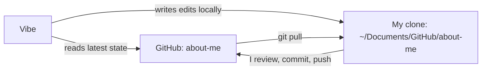

# Git Setup Notes - 2026-11-18

> Summary of today's setup: terminal git, GitHub authentication, the Vibe-GitHub connector, and our review-then-commit workflow. Part of the learning folder in the `about-me` repo.

## 1. Git in the terminal

**What I have:**
- git 2.54.0 (Apple Git-157), preinstalled on macOS (`/usr/bin/git`, provided by Apple's Xcode Command Line Tools)
- If git were missing, macOS prompts to install the Xcode Command Line Tools on first `git` use, or install explicitly:

```bash
git --version                  # verify the installed version
xcode-select --install         # installs Apple's git via Command Line Tools
```

**Verify git version (what I ran today):**

```bash
git --version
# git version 2.54.0 (Apple Git-157)
```
- A local clone of my profile repo at `~/Documents/GitHub/about-me`
- The remote `origin` points to `https://github.com/Simon-PMstack/about-me.git`

**Key mental models:**
- A cloned repo is fully self-contained: the folder on my Mac *is* the repo, with its whole history. GitHub just hosts another copy.
- `git remote` is the repo's address book: `origin` is just the nickname for the URL I cloned from. `git remote -v` lists remotes; nothing about remotes sends data.
- Local commands (`status`, `add`, `commit`) need no connection. Only `fetch` / `pull` / `push` talk to GitHub.
- Auth is not "login once for everything": it happens at push time, per repo.

**Everyday sequence:**

```bash
cd /Users/simonmeheust/Documents/GitHub/about-me
git status        # what changed (red = untracked, green = staged)
git add <file>     # stage changes (still local only)
git commit -m "message"  # record a commit (still local only)
git push origin main     # publish to GitHub
```

## 2. GitHub authentication in the terminal

**What I set up:**
- Installed **Homebrew** first (macOS package manager, required to install `gh` since GitHub CLI is not preinstalled)
- Installed GitHub CLI (`gh`) via Homebrew
- Authenticated with `gh auth login` (GitHub.com, HTTPS, browser sign-in), and let it configure git credentials

**Homebrew details (how I installed it):**

Homebrew (`brew`) is the standard package manager for macOS: a command-line installer for developer tools. Instead of downloading pkgs from websites, you install, update, and remove software from the terminal.

```bash
# Install Homebrew (one-time setup)
/bin/bash -c "$(curl -fsSL https://raw.githubusercontent.com/Homebrew/install/HEAD/install.sh)"

# After install, it prints two commands to add brew to the PATH (Apple Silicon only) - run them
echo 'eval "$(/opt/homebrew/bin/brew shellenv)"' >> ~/.zprofile
eval "$(/opt/homebrew/bin/brew shellenv)"

brew --version        # verify Homebrew works: prints "Homebrew x.x.x"

# Update the package list and upgrade installed tools
brew update           # refresh the list of available versions
brew upgrade          # upgrade installed packages
```

Useful to know:
- Homebrew installs into `/opt/homebrew` on Apple Silicon (Intel Macs: `/usr/local`)
- A "formula" is Homebrew's name for a package recipe (`brew install gh` uses the `gh` formula)
- The Homebrew PATH setup above is what makes plain `brew` (and later `gh`) work in every new terminal window

**GitHub CLI install and verification:**

```bash
brew install gh       # install GitHub CLI
gh --version          # verify: prints "gh version x.y.z"
```

**Key mental model:**
- `gh` is a separate tool from `git` (e.g. `gh auth status`, not `git auth status`).
- After `gh auth login`, plain `git push` works without further auth prompts.
- Handy extras: `gh browse <file>` opens the pushed file on github.com.

## 3. The Vibe–GitHub connector

**What it is and does:**
- The GitHub connector in Vibe (Work mode) can **read** my public repo: contents, commits, searches.
- It **cannot write** (verified: every write attempt returns 403, even after full disconnect/reconnect). The connector is read-only by design.
- Diagnosis journey: the error "Resource not accessible by integration" points to a GitHub App/ OAuth scope limit, not a misconfiguration on my side. Nothing to fix in my GitHub settings.

**Alternative for agent-side writes:**
- Vibe Code is a separate product mode that uses the Mistral GitHub App, which can clone, branch, commit, push, and open PRs on my behalf (commits authored as me). Relevant later, for heavier coding phases. See docs: docs.mistral.ai/vibe/code/web/github-repositories-permissions

## 4. Our working agreement for changes

**Workflow (GitHub is the source of truth):**

1. Vibe edits files locally in my clone (`~/Documents/GitHub/about-me`), after I approve the write in the chat prompt.
2. I review the changes in GitHub Desktop (or `git diff` in the terminal).
3. I commit and push. Nothing reaches GitHub without my explicit action.
4. Vibe reads the latest state back from GitHub in later sessions.



**Why this pattern:** the agent drafts, the human gatekeeps before `main`. Same pattern as real teams: scoped read access for automation, write access stays with the person.

## 5. Editing files locally: VS Code

**Recommended editor: VS Code** (free, from Microsoft). It's the standard in data/AI/development work, and a good long-term investment for this roadmap.

**Setup:**

1. Download from https://code.visualstudio.com and install.
2. Open the repo folder directly (not single files): File → Open Folder → `~/Documents/GitHub/about-me`.
3. Recommended first extensions:
   - **GitLens** (richer git history and blame, right in the editor)
   - **Live Preview** (for the `index.html` profile page: see changes in the browser live)
   - **Python** extension (comes into play in Phase 2 of the roadmap)
4. Useful shortcut: `code .` from the terminal opens the current folder in VS Code (enable via Command Palette → "Shell Command: Install 'code' command in PATH").

**Why VS Code over GitHub Desktop alone:** GitHub Desktop is great at review/commit/push, but it has no editor. VS Code covers the full loop: edit, see the diff, stage, commit, push, all in one place, plus the built-in terminal means I rarely leave it.

## 6. Reference links

- Repo: https://github.com/Simon-PMstack/about-me
- Roadmap: `learning/ROADMAP.md`
- GitHub CLI: https://cli.github.com
- Vibe Code GitHub permissions: https://docs.mistral.ai/vibe/code/web/github-repositories-permissions
